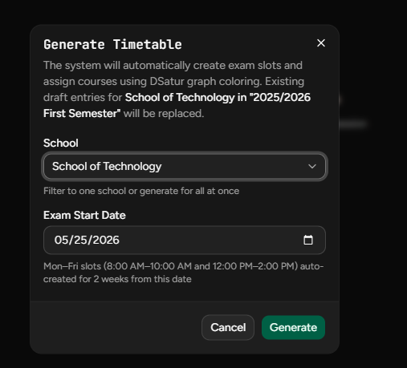
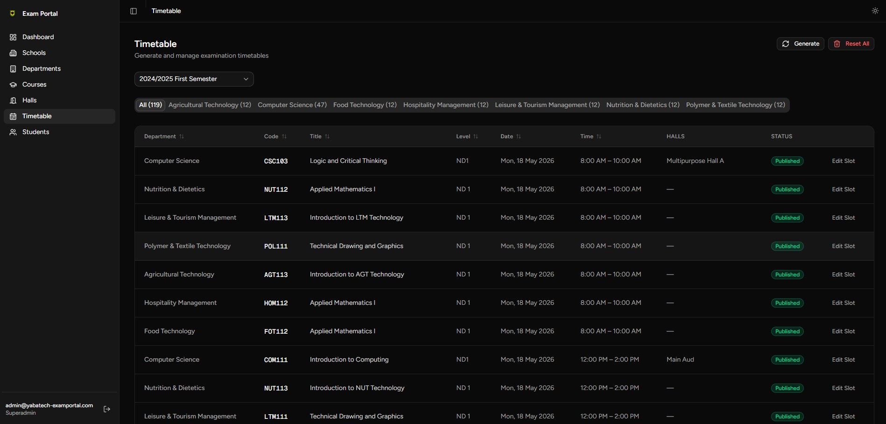
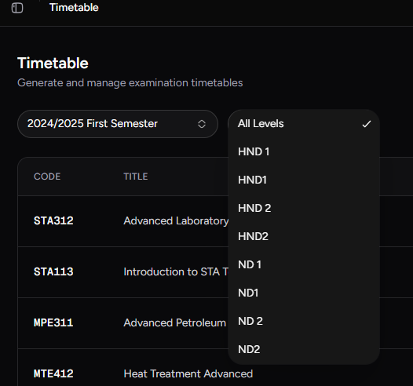
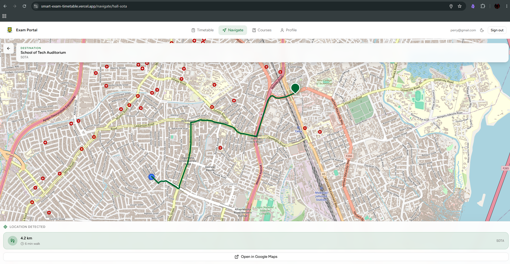
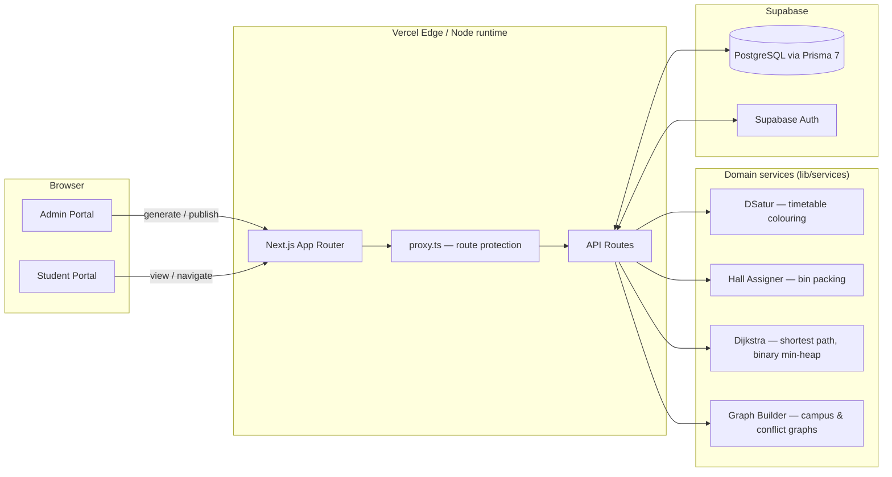

# YCT Exam Portal

**Smart Examination Timetable Generator & Real-Time Hall Navigation System**
Built for Yaba College of Technology (Yabatech) — School of Technology, Computer Science Department pilot.

[](https://github.com/m1r4g3-code/yct-exam-nav-system/actions/workflows/ci.yml)


**Live:** [smart-exam-timetable.vercel.app](https://smart-exam-timetable.vercel.app)

---

## Why this exists

Every semester, Yabatech's Computer Science department manually built exam timetables in a spreadsheet: cross-checking which courses shared students, which halls were free, and who sat where — for hundreds of students across multiple programmes and levels. Clashes slipped through, hall capacity was eyeballed, and students found out where to sit by reading a printed sheet on a noticeboard.

This system replaces that process end-to-end: a graph-colouring engine generates a clash-free timetable in one click, a bin-packing assigner seats every enrolled student across the available halls, and each student gets a live GPS-guided walking route to their exact hall — computed with a real shortest-path algorithm over the actual campus footpath network, not a straight line through buildings.

---

## Screenshots

### Admin — generate a clash-free timetable in one click

The core operation: pick a school and a start date, and the system builds two weeks of Mon–Fri exam slots and colours the course-conflict graph with DSatur — no two courses sharing an enrolled student ever land in the same slot.



### Admin — timetable command centre

Full multi-school view with per-department filters, live publish status, and per-slot editing — the operational surface an exams officer works from on publish day.



Filtering also drills down by academic level (ND1, ND2, HND1, HND2) for departments running parallel programmes:



### Admin — automatic seat assignment

Every published course pulls its enrolled roster and spreads students across halls and seats automatically, respecting hall capacity and avoiding overbooking.


### Student — personal timetable, zero ambiguity

Students see only what's relevant to them: date, time, hall, and seat number for every course they're registered for, with the next exam surfaced front and centre.


### Student — live GPS navigation to the exam hall

One tap computes the walking route from the student's live device location to the assigned hall, via Dijkstra's shortest path over a graph of real campus footpaths — not a straight line through buildings.



---

## Architecture



**Request path:** `proxy.ts` (Next.js 16's `middleware.ts` successor) gates every request on session + role before it reaches a route. Server Components fetch through a Supabase server client; interactive portals hydrate as Client Components fed by React Query. Auth sign-in runs client-side only — Supabase's session cookie write does not reliably survive a server-side `signInWithPassword` call in this stack, so the browser client owns the auth handshake and `router.refresh()` lets the proxy pick up the new session.

---

## Engineering highlights

Decisions made under real constraints, not defaults left in place:

- **Concurrency-safe timetable generation.** Generation locking is a `generation_locks` table row (`INSERT ... ON CONFLICT DO NOTHING`), not an in-memory flag — a module-level boolean would silently break the moment the app runs on more than one Vercel instance. The lock is released in a `finally` block so a failed generation can't leave the system stuck.
- **Atomic force-regeneration.** Force-deleting a draft and inserting the replacement happen inside the same `$transaction` array. If the insert fails, the delete rolls back with it — there is no window where a timetable exists in neither the old nor the new state.
- **Publish-time integrity guard.** Publishing checks `enrolledCount > studentAssignmentCount` per course, not just "does this course have a hall assignment." A course can have a hall and still leave a subset of its own students without a seat if enrollment grew after assignment ran — the guard catches that partial-overflow case specifically.
- **Dijkstra on a binary min-heap.** The original campus-routing implementation re-sorted the frontier on every iteration (`O(V²)`); routing now runs on a binary min-heap, `O((V + E) log V)`, so navigation latency doesn't degrade as the campus node graph grows.
- **N+1 elimination in the generation path.** Enrollments are fetched once, up front, into a `Map`, and passed into the hall-assignment pass — nothing queries per-course or per-student inside the transaction loop.
- **Deterministic conflict colouring.** DSatur tie-breaks on saturation degree, then raw degree, then course ID — the same input always produces the same timetable, which matters when an exams officer needs to explain *why* a slot landed where it did.
- **Cache-aware read paths.** `GET /api/sessions` and `GET /api/slots` serve `Cache-Control: public, max-age=300`, matched by a 5-minute React Query `staleTime`, so semester/slot dropdowns that rarely change don't refetch on every navigation.

Full history of audits and fixes is tracked in [`CLAUDE.md`](./CLAUDE.md) under Session Notes.

---

## Core algorithms

### DSatur — timetable generation

Models every course as a graph node; an edge connects two courses if any student is enrolled in both. Colouring the graph with DSatur (Degree of Saturation) assigns each course a time slot such that no two courses sharing a student ever collide — the same technique used for classic exam-scheduling and register-allocation problems, chosen over greedy colouring because it minimises the number of slots needed by prioritising the most-constrained nodes first.

### Dijkstra — hall navigation

The campus is modelled as a weighted, bidirectional graph (`navigation_nodes` + `navigation_paths`), built once and cached at module level. A student's live GPS coordinate is snapped to its nearest graph node, and Dijkstra's algorithm (binary min-heap priority queue) computes the shortest walking path from there to the assigned hall's node — rendered as a real route over campus footpaths via Leaflet, not a straight line.

### Hall assignment — bin packing

Enrolled students for each published course are packed across the available exam halls up to capacity, spreading overflow into additional halls rather than overbooking a single room.

---

## Stack

| Layer | Technology |
|---|---|
| Framework | Next.js 16 (App Router) |
| Language | TypeScript 5 |
| Database | Supabase (hosted PostgreSQL) |
| ORM | Prisma 7 (`prisma-client` TS generator + `@prisma/adapter-pg`) |
| Auth | Supabase Auth + role metadata (`admin`, `superadmin`, `student`) |
| Styling | TailwindCSS v4 + shadcn/ui on `@base-ui/react` |
| Fonts | Figtree (body) · JetBrains Mono (headings) · Geist Mono (code) |
| Map | Leaflet.js + react-leaflet + OpenStreetMap tiles, OSRM walking routes |
| State | TanStack React Query |
| Forms | React Hook Form + Zod |
| CI | GitHub Actions — lint, type-check, build on every push/PR |
| Hosting | Vercel |

## Data model

17 Prisma models covering the full academic hierarchy — `School → Department → Programme → Level → Course`, student enrollment (`StudentCourse`), scheduling (`TimeSlot`, `TimetableEntry`), seating (`HallAssignment`, `StudentHallAssignment`), campus routing (`NavigationNode`, `NavigationPath`), and operational safety (`GenerationLock`, `Session`). Full schema: [`prisma/schema.prisma`](./prisma/schema.prisma).

---

## Getting started

### 1. Clone & install

```bash
git clone https://github.com/m1r4g3-code/yct-exam-nav-system.git
cd yct-exam-nav-system/smart-exam-timetable
npm install
```

### 2. Environment variables

Create `.env.local`:

```env
NEXT_PUBLIC_SUPABASE_URL=your_supabase_project_url
NEXT_PUBLIC_SUPABASE_ANON_KEY=your_supabase_anon_key
SUPABASE_SERVICE_ROLE_KEY=your_supabase_service_role_key
DATABASE_URL=your_supabase_transaction_pooler_url   # port 6543
DIRECT_URL=your_supabase_direct_url                 # port 5432
ADMIN_SETUP_SECRET=a_secure_random_secret
```

### 3. Database

```bash
npm run db:generate    # generate Prisma client
npm run db:migrate     # apply migrations
npm run db:seed        # seed demo data (schools, courses, students, nav nodes)
```

### 4. Run

```bash
npm run dev
```

Open [http://localhost:3000](http://localhost:3000).

Default superadmin after seed: `admin@yabatech-examportal.com` / `Admin@2025`

---

## Commands

| Command | Description |
|---|---|
| `npm run dev` | Start dev server |
| `npm run build` | Production build |
| `npm run lint` | ESLint |
| `npx tsc --noEmit` | Type check |
| `npm run db:generate` | Regenerate Prisma client |
| `npm run db:migrate` | Run pending migrations |
| `npm run db:seed` | Seed demo data |
| `npm run db:studio` | Open Prisma Studio |

---

## Project structure

```
app/
  (auth)/         Login, register, course selection
  (admin)/        Admin portal — CRUD, timetable generation
  (student)/      Student portal — dashboard, navigation, profile
  api/            Next.js API routes (REST)
components/
  ui/             shadcn/ui components (@base-ui/react)
  map/            Leaflet map (dynamic import, SSR disabled)
lib/
  services/       DSatur, Dijkstra, hall assigner, graph builder, slot manager
  supabase/       Browser, server, and admin Supabase clients
prisma/
  schema.prisma   Full DB schema (17 models)
  migrations/     Hand-authored + Prisma-generated migrations
  seed.ts         Demo data
proxy.ts          Route protection (Next.js 16 middleware successor)
```

---

## Deployment

Deployed on Vercel. Every push to `main` runs CI (lint, type-check, build) and triggers an automatic redeploy on success.

To deploy your own instance:

```bash
npm i -g vercel
vercel link
vercel env add   # add all six env vars
vercel --prod
```
