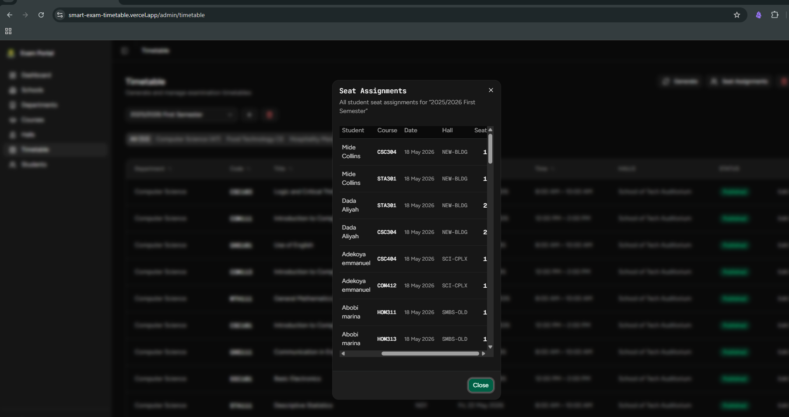
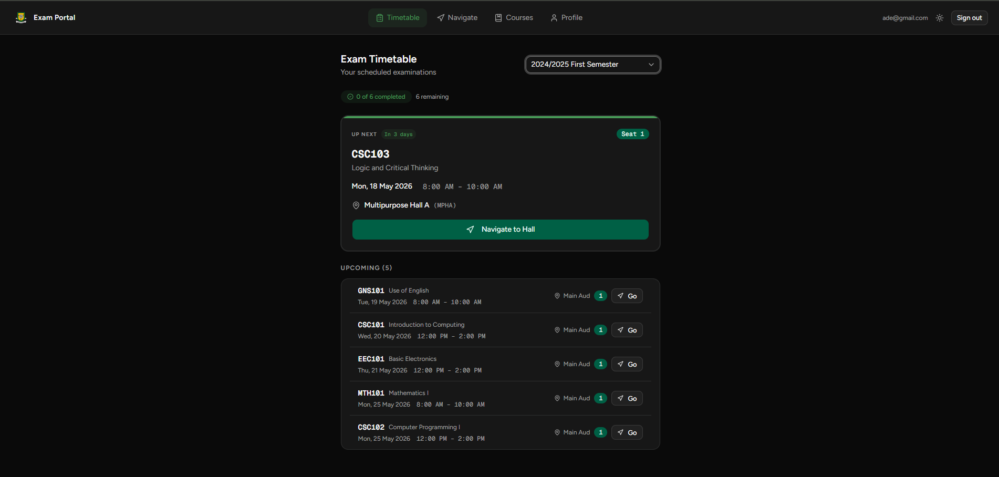
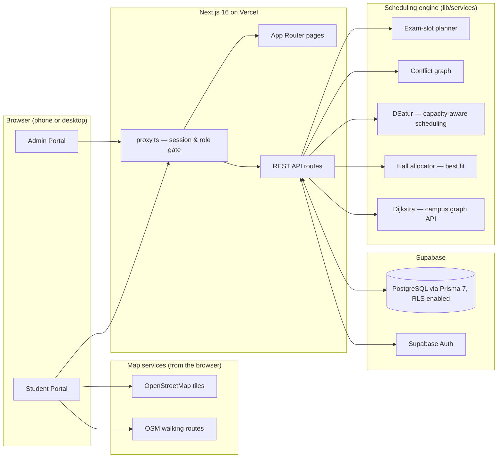

# YCT Exam Portal

**Smart Examination Timetable Generator & Real-Time Hall Navigation System**
Built for Yaba College of Technology (Yabatech) — School of Technology, Computer Science Department pilot.

[](https://github.com/m1r4g3-code/yct-exam-nav-system/actions/workflows/ci.yml)


**Live:** [smart-exam-timetable.vercel.app](https://smart-exam-timetable.vercel.app)

**Documentation (PDF):** [Project Overview](docs/presentation/YCT-Exam-Portal-Project-Overview.pdf) · [Exams Office Guide](docs/presentation/YCT-Exam-Portal-Exams-Office-Guide.pdf) · [Student Guide](docs/presentation/YCT-Exam-Portal-Student-Guide.pdf)

---

## Why this exists

Every semester, Yabatech's Computer Science department manually built exam timetables in a spreadsheet: cross-checking which courses clashed, which halls were free, and who sat where — for hundreds of students across multiple programmes and levels. Clashes slipped through, hall capacity was eyeballed, and students found out where to sit by reading a printed sheet on a noticeboard.

This system replaces that process end-to-end: a capacity-aware graph-colouring engine generates a clash-free timetable in one click, a best-fit hall allocator seats every enrolled student across the available halls, and each student gets their own timetable on their phone with a live GPS walking route to their exam hall.

---

## How it works

1. **Exams office sets up the college** — schools → departments (each automatically gets ND and HND programmes and the ND 1, ND 2, HND 1, HND 2 levels) → courses, plus every exam hall with its capacity and GPS location. Departments and courses can be bulk-imported from CSV.
2. **Students register themselves** with their matric number, choose department → programme → level, and tick the courses they are taking this semester.
3. **One click generates the timetable** — the officer picks the first exam day and the exam period (1–6 weeks, default 2). Mon–Fri slots are created (Morning 08:00–10:00, Afternoon 12:00–14:00), every course is scheduled so no level ever sits two papers at once and no slot holds more exams than there are free halls, halls are booked and every enrolled student gets a numbered seat. The result is a **draft**.
4. **Review, then publish** — department tabs, per-exam *Edit Slot* (clash-checked, halls and seats re-assigned automatically), then *Publish All*. Publishing is refused until every scheduled course has a hall, every enrolled student has a seat and every course with enrolled students is on the timetable.
5. **Students see it on their phone** — next exam with countdown, date, time, hall and seat, and *Navigate to Hall* for a live walking route.

Late registration is handled automatically: a student who enrols after generation is given a free seat in one of the course's halls straight away.

---

## Screenshots

### Admin — automatic seat assignment

Every enrolled student is placed in a hall with a seat number; the officer can review the full list per session.



### Student — personal timetable

Students see only what's relevant to them: date, time, hall and seat number for every course they're registered for, with the next exam surfaced front and centre.



More screens — including the Generate dialog, the timetable command centre and live hall navigation — are illustrated in the [Project Overview PDF](docs/presentation/YCT-Exam-Portal-Project-Overview.pdf).

---

## Architecture



**Request path:** `proxy.ts` (Next.js 16's `middleware.ts` successor) gates every request on session + role before it reaches a route: signed-out page requests go to `/login` (and return to the requested page after sign-in), signed-out API calls get a JSON `401`, and wrong-role API calls get a JSON `403`. The `(admin)` and `(student)` server layouts check the role again, and every API handler checks it a third time. Pages are Client Components fed by React Query through a shared fetch helper (`lib/fetcher.ts`) that turns failures into readable errors. Sign-in runs client-side with the Supabase browser client; the proxy picks up the new session cookie on the next request.

---

## Engineering highlights

- **Capacity-aware scheduling.** DSatur places each course in the earliest slot that has no clashing course *and* still has enough free halls to seat the whole class (checked with the same packing routine the hall allocator uses), so a slot never holds more exams than the halls can take and the exam period is spread instead of overloaded.
- **Hall bookings respected across runs.** Generating one school at a time, or several sessions over the same dates, never double-books a hall: halls already booked in a slot by timetables that a run keeps are treated as unavailable. *Edit Slot* re-plans halls and seats in the target slot using only free halls.
- **Concurrency-safe generation.** Generation locking is a `generation_locks` table row (`INSERT … ON CONFLICT`), not an in-memory flag — a module-level boolean would silently break the moment the app runs on more than one Vercel instance. The lock is released in a `finally` block, and a lock left behind by an interrupted run is taken over after 10 minutes. Writes that book halls (generation and *Edit Slot*) are additionally serialised with a Postgres advisory transaction lock and re-check hall availability inside the transaction, so two officers working on different sessions at the same moment can never book the same hall twice.
- **Atomic force-regeneration.** Deleting the old draft and inserting the replacement happen inside one `$transaction` — there is no window where a timetable exists in neither the old nor the new state.
- **Publish-time integrity guard.** Publishing checks that every scheduled course has a hall, that `enrolled ≤ seats` for every course (catching enrolments that arrived after generation) and that every course with enrolled students was actually scheduled.
- **Race-free late seating.** A late enrolee is seated inside a transaction that first locks the exam's row (`SELECT … FOR UPDATE`), then takes the lowest unused seat in the course's hall with the most room — so two simultaneous enrolments can never receive the same seat, and a seat freed by a dropped course is reused.
- **N+1 elimination in the generation path.** Courses, slots, halls, enrolments and existing hall bookings are fetched once, up front, into `Map`s — nothing queries per course or per student inside the planning loop.
- **Deterministic results.** DSatur tie-breaks on saturation, then degree, then class size, then course ID; halls tie-break on capacity then ID — the same input always produces the same timetable, which matters when an exams officer needs to explain *why* a slot landed where it did.
- **Defence in depth.** Three role checks per request, students only ever addressed through their own sign-in (never by an ID they send), roles stored in server-only `app_metadata`, and Row Level Security enabled on every table so the browser-visible anon key cannot query data directly.
- **Tested engine.** The scheduling engine, hall packing, exam-slot planning, CSV parsing and input normalisation are covered by unit tests (`npm test`), run in CI on every push.

---

## Core algorithms

### DSatur — timetable generation

Models every course as a graph node; an edge connects two courses in the **same level**, because the same students sit both. Colouring the graph with DSatur (Degree of Saturation) assigns each course a time slot so that no level ever has two papers at once — protecting every student at that level, including those who have not finished enrolling. DSatur picks the most-constrained course first (most distinct slots already used by its neighbours), which keeps the number of slots needed low. Each course goes to the earliest clash-free slot whose free halls can seat its whole class; a course with no clash-free slot left is reported as **unresolved** (choose a longer exam period), and a class bigger than the free hall space is reported as **hall overflow**.

### Hall assignment — best-fit packing

Within each slot, larger classes choose first. A class takes the **smallest free hall that seats everyone**; a class too big for any single hall fills the largest free hall and continues in the next best fit. A hall hosts one course per slot. Seats are numbered 1…n inside each hall, in matric-number order.

### Navigation

The student map (Leaflet + OpenStreetMap) shows the hall, the student's live GPS position and a **walking route with distance and walking time** from OpenStreetMap's walking-route service ([routing.openstreetmap.de](https://routing.openstreetmap.de), foot profile), re-routed as the student moves, with a straight-line estimate as fallback and a hand-off to Google Maps walking directions.

### Dijkstra — campus graph API

The campus is also modelled as a weighted, bidirectional graph (`navigation_nodes` + `navigation_paths`), cached at module level. `GET /api/navigation/path?from=&to=` runs Dijkstra on a binary min-heap (`O((V + E) log V)`) and returns the node sequence, route polyline and distance — available for campus-specific routing.

---

## Stack

| Layer | Technology |
|---|---|
| Framework | Next.js 16 (App Router) |
| Language | TypeScript 5 (strict) |
| Database | Supabase (hosted PostgreSQL, Row Level Security) |
| ORM | Prisma 7 (`prisma-client` TS generator + `@prisma/adapter-pg`) |
| Auth | Supabase Auth + role metadata (`admin`, `superadmin`, `student`) |
| Styling | Tailwind CSS v4 + shadcn/ui on `@base-ui/react` |
| Fonts | Figtree (body) · JetBrains Mono (headings) · Geist Mono (code) |
| Map | Leaflet + react-leaflet + OpenStreetMap tiles, OSM walking routes, Google Maps hand-off |
| State | TanStack React Query |
| Forms | React Hook Form + Zod (validated in the browser and again in every API route) |
| Tests | Node.js test runner via `tsx` |
| CI | GitHub Actions — lint, type-check, unit tests, build on every push/PR |
| Hosting | Vercel |

## Data model

17 Prisma models covering the full academic hierarchy — `School → Department → Programme → Level → Course`, student enrolment (`StudentCourse`), scheduling (`TimeSlot`, `TimetableEntry`), seating (`HallAssignment`, `StudentHallAssignment`), campus routing (`NavigationNode`, `NavigationPath`), and operational safety (`GenerationLock`, `Session`). Full schema: [`prisma/schema.prisma`](./prisma/schema.prisma).

---

## Getting started

Requirements: Node.js 20.19+, 22.12+ or 24+, and a [Supabase](https://supabase.com) project.

### 1. Clone & install

```bash
git clone https://github.com/m1r4g3-code/yct-exam-nav-system.git
cd yct-exam-nav-system
npm ci
```

### 2. Environment variables

Create `.env.local` in the project root:

```env
NEXT_PUBLIC_SUPABASE_URL=your_supabase_project_url
NEXT_PUBLIC_SUPABASE_ANON_KEY=your_supabase_anon_key
SUPABASE_SERVICE_ROLE_KEY=your_supabase_service_role_key   # server only
DATABASE_URL=your_supabase_transaction_pooler_url          # port 6543
DIRECT_URL=your_supabase_direct_or_session_url             # port 5432 — used by migrations
ADMIN_SETUP_SECRET=a_long_random_secret                    # one-time admin setup (optional)

# Optional: let the seed create the first super-admin sign-in
SEED_ADMIN_EMAIL=admin@yabatech-examportal.com
SEED_ADMIN_PASSWORD=choose_a_strong_password
```

### 3. Database

```bash
npm run db:generate       # generate the Prisma client
npm run db:migrate:prod   # apply all migrations (incl. row-level security)
npm run db:seed           # reference + demo data (takes a few minutes)
```

The seed loads Yabatech's 8 schools, 47 departments (each with ND/HND programmes and four levels), about 1,000 courses, 2 verified exam halls, a small campus graph and 50 demo Computer Technology students. To add 11 more campus buildings as exam halls (2,520 seats), run [`prisma/seed-halls.sql`](./prisma/seed-halls.sql) in the Supabase SQL editor, then confirm their coordinates in **Admin → Halls**.

### 4. Run

```bash
npm run dev
```

Open [http://localhost:3000](http://localhost:3000).

### 5. First admin sign-in

There is no default password. Create the first super-admin in one of these ways:

- **Seed:** set `SEED_ADMIN_PASSWORD` (and optionally `SEED_ADMIN_EMAIL`) in `.env.local` and run `npm run db:seed`.
- **Setup endpoint:** `POST /api/admin/setup` with `{ "secret": "<ADMIN_SETUP_SECRET>", "email": "...", "password": "...", "fullName": "..." }`. It works only until the first admin exists.
- **Supabase dashboard:** create the user, then set `app_metadata.role` to `"superadmin"` (or `"admin"`).

Students create their own accounts at `/register`.

---

## Commands

| Command | Description |
|---|---|
| `npm run dev` | Start dev server |
| `npm run build` | Production build (`prisma generate` + `next build`) |
| `npm run start` | Serve the production build |
| `npm run lint` | ESLint |
| `npx tsc --noEmit` | Type check |
| `npm test` | Unit tests |
| `npm run db:generate` | Regenerate Prisma client |
| `npm run db:migrate:prod` | Apply pending migrations (`prisma migrate deploy`) |
| `npm run db:migrate` | Create a new migration during development (`prisma migrate dev`) |
| `npm run db:seed` | Seed reference + demo data |
| `npm run db:studio` | Open Prisma Studio |
| `npm run db:reset` | **Erase** the database, re-apply migrations and re-seed |

---

## Project structure

```
app/
  (auth)/           Login, register, course selection
  (admin)/          Admin portal — academic structure, halls, timetable, students
  (student)/        Student portal — timetable, courses, navigation, profile
  api/              REST API routes
components/
  ui/               shadcn/ui components (@base-ui/react)
  admin/            Shared admin widgets (tables, dialogs, empty states)
  map/              Leaflet map (dynamic import, SSR disabled)
hooks/              Shared React hooks (session selection, sign-out, breakpoints)
lib/
  services/         Scheduling engine: exam slots, conflict graph, DSatur, hall packing, Dijkstra
  supabase/         Browser, server and service-role Supabase clients
  fetcher.ts        Client-side API helper
prisma/
  schema.prisma     Full DB schema (17 models)
  migrations/       Prisma migrations
  seed.ts           Reference + demo data
tests/              Unit tests (npm test)
docs/
  presentation/     Project Overview, Exams Office Guide, Student Guide (PDF + sources)
proxy.ts            Route protection (Next.js 16 middleware successor)
```

---

## Deployment

Deployed on Vercel through its Git integration. CI (GitHub Actions) runs lint, type-check, unit tests and a production build on every push or pull request to `master`/`main`.

Runtime environment variables on Vercel: `NEXT_PUBLIC_SUPABASE_URL`, `NEXT_PUBLIC_SUPABASE_ANON_KEY` (both needed at build time), `SUPABASE_SERVICE_ROLE_KEY`, `DATABASE_URL`, and `ADMIN_SETUP_SECRET` while bootstrapping. `DIRECT_URL` is only needed where migrations run.

Database migrations are not run by the build — apply them with `npm run db:migrate:prod` before deploying code that needs them.

To deploy your own instance:

```bash
npm i -g vercel
vercel link
vercel env add   # add the variables above
vercel --prod
```
